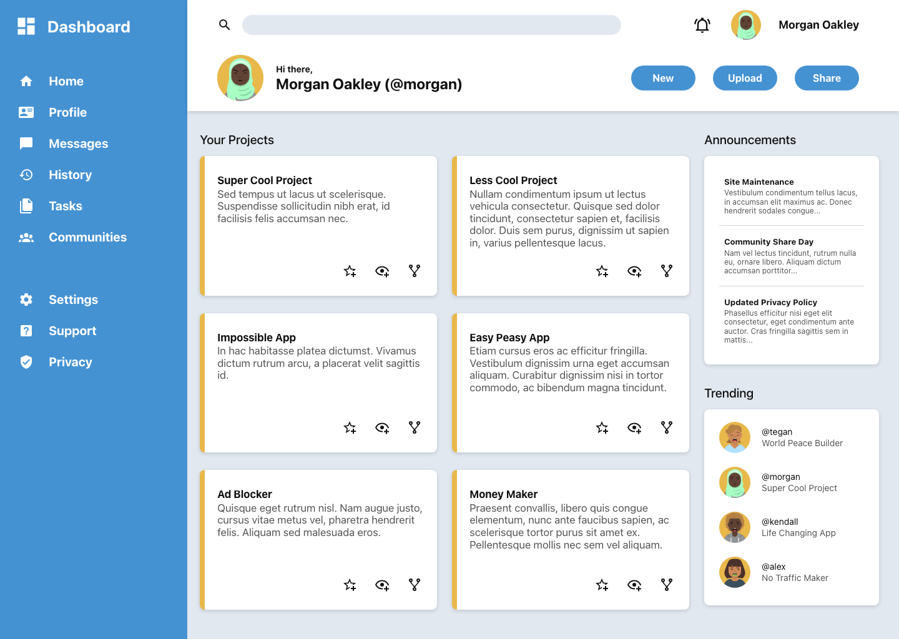

# Admin-Dashboard
Admin Dashboard to practice CSS Grid.



A static admin dashboard page built from a design mockup (`Admin Dashboard final look.png`) with plain HTML and CSS. No frameworks, no JavaScript and no build step.

## Features
- **CSS Grid only:** the page shell, sidebar, header, cards, card grid and aside all use Grid. There is no flexbox.
- **Responsive:**
  - Desktop matches the mockup.
  - At 1024px and below, the sidebar becomes icons only and the aside moves below the projects.
  - At 640px and below, the sidebar turns into a top bar with a scrollable icon nav and everything stacks in one column.
- **Accessible:**
  - Semantic landmarks, a skip link and visible `:focus-visible` rings.
  - Labelled icon-only buttons, and nav labels that screen readers still read when hidden on smaller screens.

## Run it
Open `index.html` in a browser, or serve the folder with any static server (for example the VS Code Live Server extension).

## Structure
```
index.html
styles/
  reset.css        # minimal reset
  style.css        # design tokens, layout, components, media queries
assets/
  icons/           # source copies of the MDI icons (inlined in index.html)
  images/          # avatars
docs/
  implementation-plan.md
  preview.png
```

## Credits
- Icons: [Material Design Icons](https://pictogrammers.com/library/mdi/) by Pictogrammers ([license](https://pictogrammers.com/docs/general/license/))
- Avatars: [DiceBear](https://www.dicebear.com/) "Avataaars" style, a remix of [Avataaars](https://avataaars.com/) by Pablo Stanley (free for personal and commercial use)
- Font: [Roboto](https://fonts.google.com/specimen/Roboto) from Google Fonts
